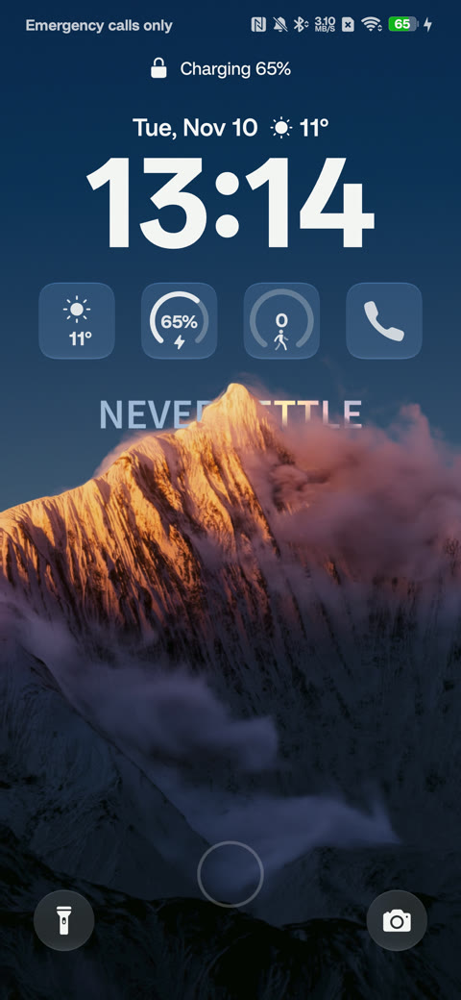
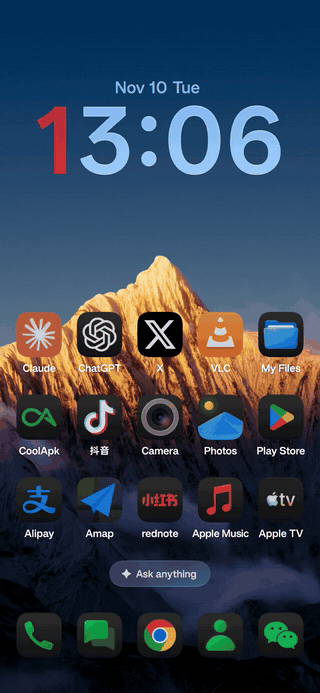
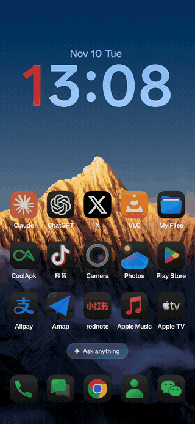
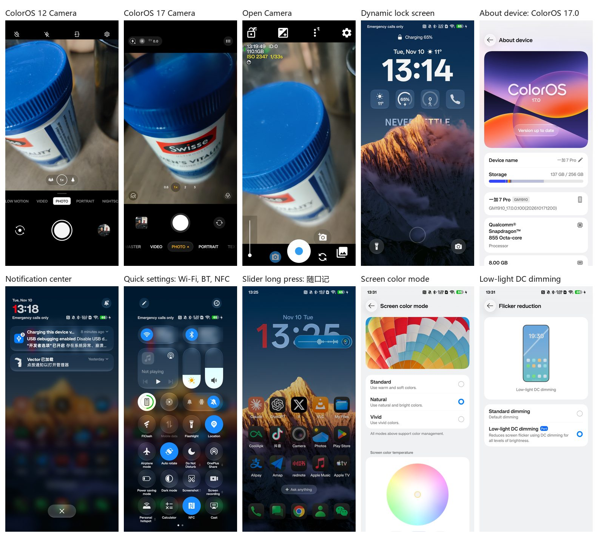

# OnePlus 7 Pro — ColorOS 17 port

ColorOS 17 (PLK110 donor GSI) running on the OnePlus 7 Pro (`guacamole`, SM8150), on top of a LineageOS 24 kernel and vendor, with selected stock H.40 pieces (camera, odm HALs). The port lives on slot B (`vendor_b`, `system_b`, `boot_b`).

  
  
  

## Release

| | |
| --- | --- |
| Current release | **17k** (local test release, not production) |
| Upgrade path | 17k is a no-wipe upgrade for a phone that already runs the port. 17d was the last full-install release; a first install on a fresh phone follows the 17d flow, which wipes userdata. |
| Download (17k-r3) | Quark share <https://pan.quark.cn/s/3dfce1464625?pwd=5VTb> (code `5VTb`) |
| Verify | Check each file against `release/17k/RELEASE-SHA256SUMS.txt` before flashing |

Binary images and release ZIPs are not stored in Git. Read the [release README](release/17k/README.md) first.

## What works

| Area | Status |
| --- | --- |
| Connectivity | Cellular (tested without a SIM card) · Wi-Fi · Bluetooth · Device Connect |
| Camera | Three camera apps, all working: Open Camera, ColorOS 12 Camera, ColorOS 17 Camera. ColorOS 17 adds new filters, Master mode and motion pictures. |
| Security and assistant | Breeno · Fingerprint · NFC (except Wallet) |
| Alert slider | Remapped to the new action button: top = single click, middle = nothing / release hold, bottom = long press |
| Display | Screen color mode · Low-light DC dimming · Eye Care |
| Look and feel | New dynamic lock screen and wallpaper · Screen-off gestures |
| Power | Dash charging |

### Proof

Screenshots taken on the phone running 17k (2026-11-10).

## Known issues

| Issue | Reason / plan |
| --- | --- |
| Wallet cards for banks and transit | Bootloader is unlocked (security); being fixed |
| Adaptive tone | No ambient color sensor; the setting will be removed later |
| Reverse wireless charging | No hardware; the entry will be removed later |
| Wallpaper resets on reboot | A script re-applies it, but details such as the depth effect may be missing |

## Documentation

| | |
| --- | --- |
| [release/17k/README.md](release/17k/README.md) | What the release contains and how to install it |
| [release/17k/docs/README.md](release/17k/docs/README.md) | Documentation index: architecture, fixes and patches, discoveries, merge principles, open items |
| [release/17k/FACTS.md](release/17k/FACTS.md) | Hashes and verified facts of the shipped images |
| [release/17k/BUILD_SOURCES.md](release/17k/BUILD_SOURCES.md) | Build inputs and how to rebuild |
| [release/17d/source/history/](release/17d/source/history/) | Original working handoffs and test notes, 2026-10-14 to 2026-10-17 |

## Others

Hosting is welcomed for users who don't want to use Quark Drive. Please link to this readme when hosting.

## Credits

This port stands on two projects. Thank you to both:

- **[LineageOS](https://lineageos.org/)** - the kernel (`android_kernel_oneplus_sm8150`, 4.14), the vendor image, device trees and the guacamole nightly builds that provide the hardware layer of this port. Downloads: <https://download.lineageos.org/devices/guacamole/builds>.
- **Axis GSI** (`axisgsiupdates`) - the ColorOS 17 (PLK110) GSI that is the system donor. Releases: <https://sourceforge.net/projects/axisgsiupdates/>.

ColorOS, OxygenOS and OnePlus/OPPO firmware remain the property of their owners; this repository ships only build scripts, patches and documentation (images are distributed separately).

## License

The original scripts, installers, patches and documentation in this repository are released under the [Apache License 2.0](LICENSE) (see also [NOTICE](NOTICE)). Kernel driver code (the eSE p73 driver and its patch) is GPL-2.0-only, and some bundled third-party files keep their own licenses: see [THIRD-PARTY-NOTICES.md](THIRD-PARTY-NOTICES.md). ColorOS, OxygenOS and OnePlus/OPPO firmware are not covered by this license.

This project is not affiliated with OPPO, OnePlus, LineageOS or Axis GSI. Flashing a phone can brick it and erase its data; everything is provided as is, without warranty, and you use it at your own risk.
