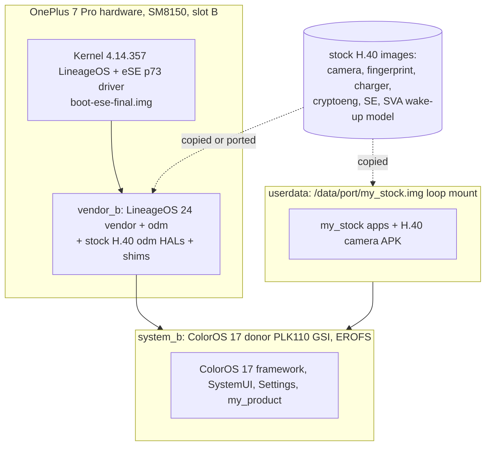

# 17d docs — what is in this build and why

Written 2026-10-17 from the live handoffs (`handoff-2026-10-17.md`, `PORTING.md`) and the side-session notes. Read in this order:

| File | What it is |
| --- | --- |
| [ARCHITECTURE.md](ARCHITECTURE.md) | How the pieces fit: LineageOS 24 base, ColorOS 17 donor, stock H.40 parts, partitions, boot chain |
| [FIXES-AND-PATCHES.md](FIXES-AND-PATCHES.md) | Every fix baked into 17d: symptom, root cause, patch, where it lives, how it was verified |
| [DISCOVERIES.md](DISCOVERIES.md) | Facts learned while porting (hardware, firmware, ColorOS internals, tooling quirks) |
| [PRINCIPLES.md](PRINCIPLES.md) | Rules for merging and patching so a new fix does not break the working build |
| [OPEN-ITEMS.md](OPEN-ITEMS.md) | Not in 17d: live-only patches, 17e, known issues, test checklist, rollback |

Scope note: **17d** = build 16 contents + build 17 additions (charger / cryptoeng / AIDL charger stand-in, odm shims, Breeno wake-up on the H.40 DSP, eSE stack) + the eSE kernel (`boot-ese-final.img`, flashed separately). The release ZIPs additionally use production properties (`PROD_PROPS=1`: `ro.secure=1`, `ro.debuggable=0`), which removes adb root; see `../README.md`, `../FACTS.md`. Everything marked *live only* below is NOT in the 17d images.

## One-picture overview

